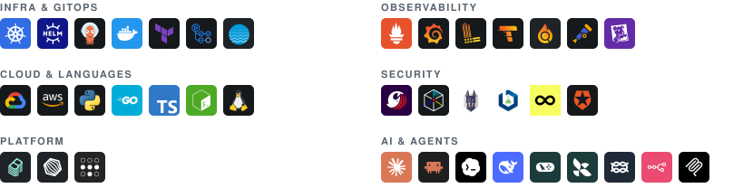

<picture><source media="(prefers-color-scheme: dark)" srcset="assets/imgs/manga-cutout.png"></picture>

<picture>
  <source media="(prefers-color-scheme: dark)" srcset="https://readme-typing-svg.demolab.com/?font=Fira+Code&weight=500&size=24&duration=3500&pause=400&color=E6E6E6&vCenter=true&multiline=true&repeat=false&width=600&height=74&lines=Hi%2C+I'm+Tristan;DevOps+Engineer+%C2%B7+AI+Platform+%26+LLMOps">
  
</picture>

<pre>
From 24/7 banking production ops to DevOps and AI engineering.

I build the platforms that let engineering teams put AI to work safely.
Design agentic workflows, give AI assistants secure access to internal
tools, keep LLM cost and quality in check, and help teams adopt AI in their
daily work.

Also a Grafana dashboard and terminal ricer, because why not.
No hard feelings if my zsh looks better than yours.
</pre>

 

<picture>
  <source media="(prefers-color-scheme: dark)" srcset="assets/stack-dark.svg">
  
</picture>

<picture>
  <source media="(prefers-color-scheme: dark)" srcset="assets/label-certifications-dark.svg">
  
</picture>

  
  

<picture>
  <source media="(prefers-color-scheme: dark)" srcset="assets/label-open-source-dark.svg">
  
</picture>

####  [datadog-mcp-server](https://github.com/TANTIOPE/datadog-mcp-server) · Creator

MCP server that gives AI assistants access to Datadog, released before the official one. ~40k npm downloads.

- **22 tools**: logs, metrics, traces, monitors, SLOs, incidents, dashboards and more
- **Cross-correlation**: from a log to its trace to the service's latency metrics
- **Token-efficient**: log sampling and compact modes keep responses small
- **Safe writes**: read-only mode and dry-run validation

####  [stacklok/toolhive #5996](https://github.com/stacklok/toolhive/pull/5996) · Contributor

Every client session re-embedded the whole tool catalogue.

- **Before**: 16–19 s per session at 140 tools, so the claude.ai connector timed out loading tools on every connect
- **After**: sub-second, zero embedding calls once warm
- **Fix**: cache keyed on the tool text and the live model id

<picture>
  <source media="(prefers-color-scheme: dark)" srcset="assets/label-at-work-dark.svg">
  
</picture>

####  SRE investigation agent · LangGraph multi-agent

Investigates incidents from the alert to the root cause, and proposes a quick patch and a lasting fix.

- **Three causal gates**: the cause must start before the symptom, hit the broken scope but not its healthy siblings, and have a concrete mechanism
- **Verbatim evidence**: every quote must match the real tool output, so hallucinated evidence never reaches a verdict
- **Human-approved fixes**: proposes an immediate patch (restart, scale, config value) or a lasting fix as a pull request; a separate executor with no LLM holds the write permissions and acts only after an authorized approver clicks in Slack
- **Memory**: each report versioned in Git, past investigations recalled on new incidents
- **Locked down**: read-only `kubectl exec` enforced by a CEL admission policy, secrets masked before the model
- **LLM observability**: self-hosted Langfuse, one trace per investigation, per-model cost, and a per-run spend cap that stops the agent cleanly
- **Evals**: a scorer written in code, with no LLM judge, that replays recorded runs on cases taken from real alerts

####  MCP gateway

Opens internal tools to claude.ai and Claude Code, behind company SSO.

- **OAuth 2.1**: Python gateway (FastMCP) with Auth0, issuing its own audience-bound tokens
- **Per-tool authorization**: separate tool bundles for business and tech users
- **Audit**: every tool call logged per user
- **Lean context**: ToolHive lets assistants find tools on demand instead of loading them all

  <picture>
    <source media="(prefers-color-scheme: dark)" srcset="https://streak-stats.demolab.com/?user=TANTIOPE&hide_border=true&background=141414&ring=B3282D&fire=B3282D&currStreakNum=E6E6E6&sideNums=E6E6E6&currStreakLabel=D9474E&sideLabels=D9474E&dates=8A8A8A&stroke=3A3A3A">
    
  </picture>

